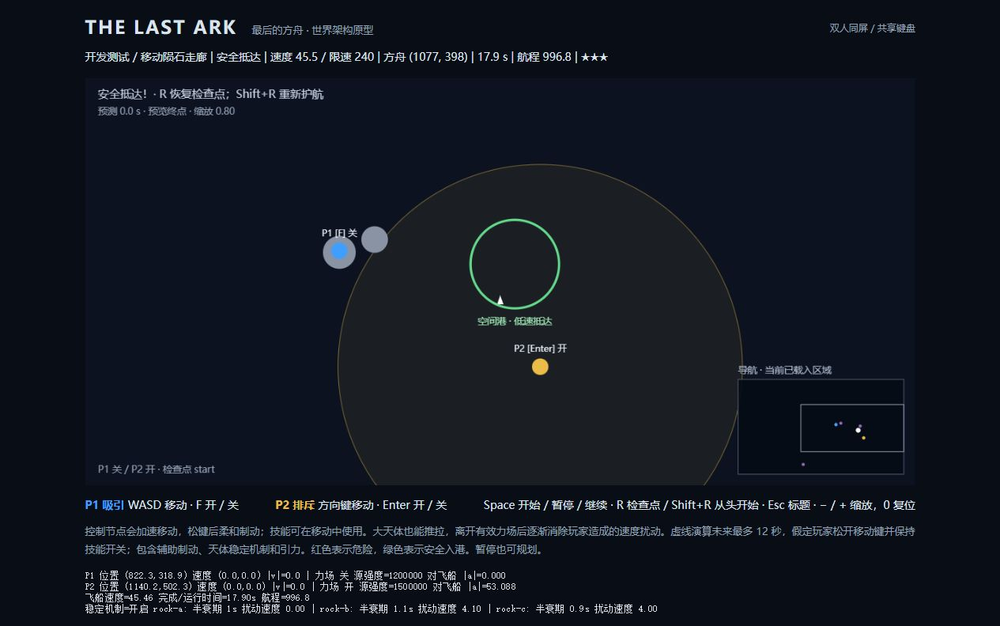
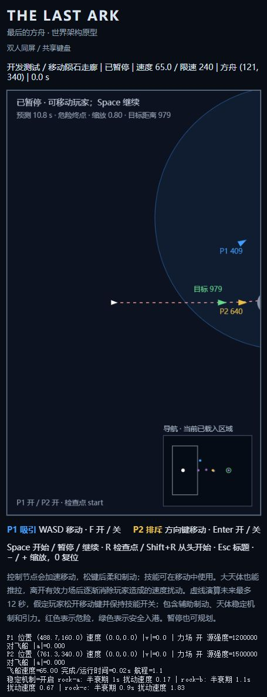

# THE LAST ARK · 最后的方舟

双人共享键盘的二维太空合作游戏。人类最后的移民飞船寻找家园，两名观察者只能通过吸引与排斥改变天体运动，不能直接驾驶方舟。

当前完成了**大世界架构升级、节点惯性控制、非飞船天体稳定机制，以及渲染与视觉效果**（视差星空、弧长尾迹、天体渐变、引力场可视化），基于原有 TypeScript + Vite + Canvas 2D 原型增量开发。原试玩“绕行与制动”仍可通关，并新增仅在开发模式开放的合作测试场景；后续教学、太阳系、黑洞与无限探索只做路线设计和接口预留。完整路线与架构契约见 [GAME_DESIGN.md](docs/GAME_DESIGN.md)。

## 启动

本地验证环境：Windows、Node.js 24.20.0、npm 11.19.0。

```bash
git clone https://github.com/nathancao321-source/the-last-ark.git
cd the-last-ark
npm install
npm run dev
```

打开终端显示的地址（默认 http://127.0.0.1:5173/，占用时使用下一个端口）。当前开发页面在 http://127.0.0.1:5174/。标题页按 Space 或点击“进入原试玩关”，再按 Space 发射。游戏启动后无需联网；需要桌面键盘。

```bash
npm test           # 全部自动化测试
npm run test:watch
npm run build      # 严格类型检查 + Vite 生产构建
npm run preview    # 预览生产构建
npm run check      # 测试与构建
```

依赖版本由 package-lock.json 锁定，CI 使用 npm ci。开发服务器仅监听本机回环地址。

## 操作与玩法

| 操作 | 按键 |
| --- | --- |
| P1 蓝色玩家移动 / 切换吸引 | WASD / 点按 F |
| P2 金色玩家移动 / 切换排斥 | 方向键 / 点按 Enter |
| 进入试玩、发射、暂停、继续 | Space |
| 恢复最近检查点并关闭力场 | R |
| 从当前关卡最初状态开始 | Shift+R |
| 返回标题 | Esc |
| 缩小 / 放大 / 恢复默认视角 | − / +（等号键） / 0 |

- 技能按一下开启，再按一下关闭；松开保持，长按不会重复切换。合力按矢量叠加，飞船、陨石和可移动行星都会受力。
- 玩家不受引力或碰撞影响，对角移动不会加速。待发射和暂停时可移动玩家、调整技能；天体和计时冻结。
- 所有实体使用世界坐标，**屏幕边缘不再是边界**。镜头平滑跟随飞船并按速度前瞻；玩家离屏显示方向箭头。缩放、窗口尺寸和 DPR 不改变模拟。
- 右下角小地图显示已加载区域、玩家、方舟、目标与镜头范围；绿色边缘箭头指向当前目标。当前没有限制玩家与方舟的距离，也没有自动传送。
- 白色三角是方舟，灰圆是陨石，紫圆是可推拉的大行星，绿环为空间港。飞船撞击危险天体或进入捕获区立即失败。
- 飞船必须完整进入空间港，速度 **≤ 48 世界单位/秒** 才胜利；天体硬限速为 **240**。高速掠过不会算完成。
- 虚线是对当前全部已加载天体进行最多 12 秒的真实积分预测，10 Hz 刷新。红色表示危险，绿色表示安全抵达；它假定玩家松开移动键并保持技能开关（会模拟节点辅助制动）。暂停也能规划，不会推进真实状态。
- 失焦/页面隐藏自动暂停运行中的游戏，释放移动按键但保留技能开关。方向键、Space、Enter 不触发滚动。
- R 恢复内存检查点；Shift+R 完全重开。刷新页面或返回标题后重新进入会从关卡起点开始，目前没有持久存档。

## 保留的试玩关与通关路线

旧 1100 × 620 尺寸现在只作关卡参考，不是物理边界。飞船从 (120,340)、速度 (65,0) 出发；行星中心 (550,340)、半径 65；空间港中心 (970,340)、半径 68；原陨石保留。完全不操作时约 5.4 秒撞毁。

<details>
<summary>展开已验证的合作路线（含剧透）</summary>

1. P1 保持初始 (350,160)，将 P2 移到约 (1050,420)。
2. 按 F 开启吸引并发射。飞船到 x≈420 时关 F（约 4.4 秒），从行星上方惯性绕行。
3. 到 x≈650 时暂停，把 P1 移到 (690,320) 附近。此时正常上方绕行路线已经保存 after-bypass 检查点。
4. 开 F、继续约 1.2 秒后暂停，关 F、开 Enter，让 P2 进行制动。观察是否出现绿色“安全入港”预测。
5. 绿色时保持位置和开关继续。如果未对准，可暂停调整 P2 或短暂继续 P1 转向后再检查。

27 组原有路线覆盖关闭位置 x=410/420/430、转向位置 x=640/650/660 和三种转向结束方向；另有 3 条路线使用预测作为制动继续条件。全部只使用正常玩家移动与力场，没有修改飞船位置或速度。

本轮架构升级后实际浏览器按该路线完成：**12.1 秒、速度 47.9、方舟 (958,330)** 安全抵达。实际键盘事件工具的时长存在少量偏差，因此不要依赖毫秒级时机；暂停和轨迹预览是规划机制的一部分。

</details>


## 架构变化

```text
src/
  camera/    世界/屏幕坐标变换、平滑跟随、离屏箭头、小地图映射
  scenes/    SceneId、可用/规划场景注册表、场景控制器
  game/      统一实体定义、能力配置、任务/触发器、检查点、固定时钟、预测
  physics/   控制节点动力学、向量、软化力场、体积引力、Verlet 积分、扫掠碰撞
  world/     区域几何、多分辨率空间索引、区块接口、确定性随机数
  levels/    first.ts：保留原试玩配置与绕行检查点
  input/     统一玩家意图、独立输入通道、双键盘、世界目标采样工具
  render/    palette 颜色常量、scene-visuals 渲染状态、starfield 视差星空、trail 弧长尾迹、
             celestial 天体渐变、field-visuals 引力场可视化、canvas 装配与 HUD、visibility 裁剪
  main.ts    组合场景、输入、固定时钟、镜头与视图
tests/       物理、通关、预测、相机、导航、场景、任务、检查点、空间索引
docs/        完整游戏路线与浏览器验收截图
```

**Scene 与 Phase 分离。** 场景有 title、prototype、tutorial_part_1、tutorial_part_2、solar_system、black_hole、endless；游戏阶段有 ready、running、paused、failed、completed。后续场景标记 planned，无法进入。转场由显式任务条件触发，不读取屏幕坐标。

**统一实体按能力参与模拟。** 支持 ship、player、asteroid、planet、star、black_hole、station、wormhole。motion 区分动态、静态、预设运动；emitsGravity、collision、affectedByFields、response 等可独立配置。background 实体只显示。行星默认 response=0.18，恒星默认 0.02，黑洞默认 static；太阳可弱推、黑洞不可推的差异不写进积分器名称分支。恒星/虫洞等目前只有数据支持与测试，未加入试玩内容。节点惯性与选择性稳定的配置见文末追加章节。

**任务与触发器已经可执行。** 支持进入圆/矩形区、低速入区、移动指定天体、穿过轨道带、前置任务、阶段提示、虫洞转场、完成和检查点。原试玩使用 station 实体低速入港目标，以及绕行后检查点。R 还原实体、计时与任务记录后关闭技能，Shift+R 从头重置。

**世界装载与视觉裁剪分离。** 离屏物体继续受力、运动和碰撞；只绘制可见实体。当前试玩全部对象驻留内存。局部引力使用空间索引查询影响范围，不遍历全宇宙天体配对。区块 load/save/unload、种子派生和需求规划只是扩展接口，尚无运行中的区块加载器。

## 物理模型与保留能力

- 固定步长 1/60 秒；每帧最多补算 15 步。Velocity Verlet 分别采样天体移动前后的引力，渲染完全独立。
- 单源加速度：`min(a_max, strength / (d² + softening²) × (1 − (d/R)²)²)`；范围外与完全重合时为 0。
- 球体质量 `4πr³/3 × density`，参考半径 65、密度 1、源强度 110000；范围默认 `max(120,r×330/65)`，软化 `max(24,r×85/65)`。同密度半径翻倍源强度为 8 倍。配置可以关闭某实体的引力或覆盖作用半径。
- 合加速度上限 170，速度上限 240；可设置单体更低限速。每半步都执行限速。触及限速会丢弃动能，是游戏化取舍。
- 飞船/陨石响应 1，原行星 0.18。大天体确实能被吸走或推开，关技能后继续惯性运动。响应系数不等于严格质量反作用，不保证全系统动量守恒。
- 引力弹弓来自移动引力源本身，没有额外速度奖励。回归测试验证静止源掠飞的远场速度近似不变，以及移动源两侧分别增速/减速。
- 空间索引在每半步按当前源位置重建；多个格子中的相同候选去重，保持稳定求和顺序。危险碰撞使用扫掠 AABB 候选与相对扫掠圆检测。
- 离屏不移除天体；capture 危险可以移除非飞船动态天体。飞船捕获直接失败。只有显式 missionBounds 才会发生任务边界失败，试玩不设置该边界。
- 不模拟天体之间的弹性碰撞，不做完整天体力学。预测遇到胜负或转场停止；下一场景不由当前预测偷偷启动。

## 已实现与预留范围

| 状态 | 内容 |
| --- | --- |
| 已实现并接入试玩 | 原有合作机制、点按技能、大天体推拉、体积引力、弹弓模型、限速、预测、世界坐标、平滑镜头/前瞻/缩放、离屏提示、小地图、标题/试玩状态机、任务目标、绕行检查点、局部空间查询、可见实体裁剪 |
| 已实现通用能力并测试 | 八类实体、能力覆盖、圆/矩形/轨道带条件、依赖目标、提示/完成动作、移动目标/虫洞触发转场、独立场景配置及重置 |
| 仅设计或接口 | 两段教学、Solar Exodus、Beyond the Horizon、Endless、隐藏内容、SectorProvider、基于种子的星域生成基础、有限区块需求规划 |
| 尚未实现 | 新关卡/新星球内容、运行中的区块加载卸载、程序化宇宙、持久存档、加载过渡、Worker 预测、远场近似、渲染插值、音效、后处理、碰撞/引擎粒子、屏幕震动、手机/手柄、联网合作 |

视觉层**已实现**（见文末 2026-10-16 章节）：星空、尾迹、天体渐变与引力场可视化全部只读消费 GameState / Camera / Trajectory，状态活在独立渲染状态里；粒子仍未做，HUD 读取 SceneId / Phase / MissionState。区块扩展实现 SectorProvider 与调度器，确保保存移动态、加载跨区引力邻域，不以镜头决定物理活跃范围。详见设计文档。

## 验证记录

2026-10-14 架构升级验收：

| 检查 | 结果 |
| --- | --- |
| 原有基线 | 修改前 67 项测试与构建通过；原有 30 条通关回归在架构升级后继续通过 |
| 自动化 | 本轮 104 项测试通过；新增摄像机变换、视口独立、边缘方向、小地图、场景切换、计划场景拒绝、实体能力、任务/检查点、局部索引和确定性种子覆盖 |
| 原有数值稳定性 | 保留 10 分钟模拟、重叠力场、硬限速、不同数组顺序、静态/移动源掠飞、逐点预测一致性测试 |
| 帧率独立 | 相同输入在 30 / 60 / 144 渲染 FPS 得到相同模拟状态；改变窗口尺寸和镜头缩放不改变状态 |
| 构建 | npm run build 严格类型检查与生产打包通过 |
| 开发服务 | 现有 npm run dev 服务正常，127.0.0.1:5174 页面和热更新可用 |
| 浏览器操作 | 实测标题进入/返回、双人同时移动、点按技能、暂停/继续、镜头跟随、缩放、小地图及离屏箭头；窗口改为 800×700 后暂停坐标/速度/计时一致，随后恢复默认视口 |
| 浏览器胜负/重试 | 原路线 12.1 秒、47.9 低速抵达；R 恢复 (640,217) 绕行检查点并关闭双力场；Shift+R 回到 (120,340)；无干预约 5.4 秒撞毁 |
| 浏览器控制台 | 本轮检查未发现 warning/error |
| 真人双人验收 | 仍待实际两人共用实体键盘验证多键冲突、协作手感、长时间游玩与更多浏览器 |
| 无限宇宙性能 | 未验收：未实现无限生成/装载；只验证局部查询避免稀疏对象全配对，不能据此宣称支持任意规模 |

原始安装阶段 npm install 成功，未增加本轮运行依赖。GitHub Actions 在 push/PR 自动执行 npm ci 和 npm run check；CI 状态以仓库 Actions 最新运行结果为准。

旧版截图保留在 docs 中，架构阶段验收截图为 architecture-win.png，最新控制与稳定机制的截图为 cooperation-win.png，旧截图不作为新版界面的验收证据。

## 许可证

[MIT](LICENSE)。所有画面均为代码绘制的基础几何形状，不含未经授权的美术或音乐素材。

## 2026-10-15：控制节点、稳定机制与合作测试

蓝色与金色节点是高维文明投射的**引力场控制中心**，不是普通物理天体。节点使用独立控制动力学，不受天体引力或反作用力；真实飞船仍有惯性，蓝/金场都能做功。没有人为禁止轨道捕获、强制限时失败或强制双技能门锁。

### 默认手感与参数

| 配置 | 默认值 | 含义 |
| --- | --- | --- |
| 玩家 speed | 260 世界单位/秒 | 高于原试玩巡航 65，也略高于飞船硬上限 240，便于跟上方舟 |
| 玩家 acceleration | 650 世界单位/秒² | 约 0.4 秒到最高速；反向输入先减速再加速 |
| 玩家 braking | 260/0.6 ≈ 433.33 世界单位/秒² | 松键约 0.6 秒停下；满速松键滑行约 76 世界单位 |
| 原试玩行星 stabilization.halfLife | 1.2 秒 | 只衰减玩家注入的速度扰动 |
| 原试玩陨石 stabilization.halfLife | 1.0 秒 | 初始 (-3,-1) 漂移和环境引力贡献保留 |
| 稳定机制 rampSeconds | 0.25 秒 | 离开有效力场后平滑增强阻尼 |
| sleepSpeed | 0.03 世界单位/秒 | 仅把极小的玩家扰动归零，不清空轨道/环境运动 |
| fieldEpsilon | 0.0001 世界单位/秒² | 判定任一玩家是否仍有效作用 |
| 评分阈值 | ≤18 秒三星，≤30 秒二星，其余一星 | 每关独立配置；无倒计时失败 |

运动模块为 physics/player.ts：目标速度由输入给出，每步速度变化最多 acceleration×dt，松键改用 braking×dt。F/Enter 仍是点按开关；长按或节点移动都不会禁用技能。暂停期间节点仍可运动并制动，普通天体保持冻结。

预测现在假设**松开移动键、保持技能开关**：节点已有速度会继续按相同辅助制动减速，而不是在预测中瞬间固定。节点停稳后的预测与原先一致。

稳定机制是可关闭的游戏化近似：保存直接来自玩家加速度的速度分量 `v_player`，其余 `v_base = v_total - v_player` 包括初始运动和环境引力积分。无有效玩家力场时仅对 `v_player` 使用指数衰减，基础运动不受阻尼。恒星引力支持的公转由已有引力积分继续推进，不会因稳定机制停转；**这不是把受扰天体恢复到原始轨道，也不拉回出生位置**。玩家扰动引起位置变化后，自然引力也会变化，因此可能永久改变轨道；当前没有分析轨道控制器。

任一玩家的有效施力存在时不额外阻尼（两个力场抵消也算有效）；离开范围或关场后用连续 ramp 启动。半衰期是阻尼完全启动后的速度减半时间。飞船能力明确禁止该阻尼，即使误填 stabilization 也不会生效；黑洞仍为静态。所有分量、启动计时、航程都随检查点深拷贝保存，纯惯性对照仍保留原本限速/软化引力规则。

### 开发模式

以下参数**只在 npm run dev 下生效**，生产构建不开放测试场景和调试面板。端口按实际开发服务替换：

- 原试玩调试数据：`http://127.0.0.1:5174/?dev=1`
- 合作测试场景：`http://127.0.0.1:5174/?dev=1&scene=coop_test`
- 纯惯性对照：追加 `&stabilization=off`
- 原试玩独立半衰期：追加 `&halfLife.planet=0.8&halfLife.asteroid=1.5`
- 合作场景独立半衰期：追加 `&halfLife.rock-a=0.8&halfLife.rock-b=1.5`
- 调整两节点手感：追加 `&moveSpeed=260&moveAcceleration=650&moveBraking=433.333333`

参数会写入独立关卡配置，再由真实模拟与预测共同读取；无效数值被忽略，不会注入 NaN。半衰期允许 0.1–30 秒，建议先试 0.8–1.5 秒。刷新/更改 URL 会重开场景。调试区显示 P1/P2 世界位置、速度向量/大小、开关、源强度、实际对飞船的加速度大小、飞船速度、时间、航程、各天体扰动速度和当前半衰期。

### 开发合作场景与可复现路线

新增 cooperation.ts 是测试夹具关卡，不属于后续剧情章节。三颗陨石半径 23/26/21，拥有不同初速度，全部接受原有引力、玩家力场和碰撞规则。前两颗会被推离航道，第三颗和再次施力引起的相互干扰要求玩家考虑转向时机。没有检查玩家 ID 的通关机关。

可复现路线（允许暂停部署，移动后先等节点速度回到 0）：

1. 发射前 P1 保持 (350,160)，P2 调至 (450,290) 附近。
2. 两技能都打开，飞船到 x≈300 时同时关闭（约 2.9 秒）。P1 影响航向，P2 清理航线陨石，同时也会对飞船做功。
3. 惯性前进至 x≈780–820，暂停。P1 放到飞船前方约 40、y≈320，P2 放到 (1180,420)。
4. 只开 P1，短暂转向；暂停后关 P1、开 P2，观察是否有绿色安全入港预测。自动回归使用飞船当前切线投影到 x=1100 时的 y≈370 或 400 作为切换条件，实际试玩推荐直接看预测。
5. 若转向略多，可暂停把 P2 调到更靠下的制动位置。浏览器本次实际采用 P1≈(822,319)、最终 P2≈(1140,502)，绿色预测后继续，17.9 秒、航程 996.8、速度 45.5 安全抵达。

6 条自动路线覆盖转向 x=780/800/820 和两种切线方向，全部成功；原试玩 30 条路线也继续通过。测试用普通键盘方向输入及有限加速度部署节点，不瞬移或编辑飞船状态。

这些结果证明场景可通关、技能相互作用存在；**尚不能证明合作必然比单人更快**。仍需两人实体键盘试玩，重点体验 0.6 秒制动滑行、提前刹停定位、陨石半衰期、转向提示与两人分工。原型允许无限慢地完成。



### 本次追加验收

- 140 项自动测试、TypeScript 严格检查和生产构建通过。
- 新增加速/制动/反向、移动中同时开技能、帧率独立、飞船正负功与束缚轨道、环境引力公转、扰动半衰期/平滑启停/再入场、检查点/预测一致性、评分和 6 条合作路线测试。
- 浏览器实测节点惯性及两技能同时移动；合作场景完整入港并显示三星、完成时间和真实航程。关场 10 秒后 rock-a 扰动从约126.95降到0.13，飞船仍以约48速度续航。开发 URL 的纯惯性选项和两个独立半衰期已实际核对。
- 本轮浏览器控制台未发现 warning/error。教学与太阳系尚无关卡内容，无法宣称已试玩这些章节；它们的 planned 状态与拒绝进入行为仍有回归测试。
- 评价仅在 completed 显示，航程按每物理步实际位置差累计；暂停不计时/航程。检查点恢复会回滚对应进度，不是累计失败尝试的竞速排行榜。`mode: 'exploration'` 或未配置 scoring 时不显示限时星级。

## 统一输入接口（2026-10-15 追加）

实际游戏循环现在经过 `Keyboard.source(0/1) → PlayerInputs → Controls.players → physics/player.ts`。每个玩家只接收一个 `PlayerControlIntent`：`moveX / moveY`、`abilityActive`、可选 `targetWorldPosition`。输入层不持有玩家实体，也不修改物理位置/速度；加速度、惯性、最大速度、辅助制动与场开关应用统一在物理层。

- `PlayerInputs.setSource(player, source)` 按玩家独立替换输入通道，支持未来键盘+键盘、键盘+手柄、鼠标+手柄的组合。当前接入的仍是原双键盘；F/Enter 的点按开关、对角归一化与全部移动参数保持不变。
- `PlayerInputSource` 提供 `read / releaseMovement / reset`。切换通道时清理该玩家新旧来源的残留输入，不影响另一玩家；重试/切场景清理全部意图；失焦释放方向与目标、保留技能开关。硬件断连时未来适配器必须 reset 并输出中性意图，由动力学柔和制动。
- 意图快照与设备缓冲区分离，拒绝非有限坐标/轴值。摇杆幅度保留，长度超过 1 的方向由物理层限幅；摇杆死区、按钮切换和设备断连检测属于未来适配器。
- 可选目标的物理分支已实现并测试：有限加速度追踪、按制动距离提前减速、近目标平滑收敛。`Player.targetArrivalSeconds` 默认 0.25 秒，仅影响目标追踪，不影响键盘；非零移动轴优先于目标，清除目标后正常辅助制动。不会直接写目标位置或瞬间清零速度。
- `WorldTarget.capture` 只应在新的鼠标位置操作事件发生时调用，将 client CSS 坐标经 Canvas 偏移/尺寸和当时摄像机转换成世界点。之后只读取该世界点；镜头跟随、缩放、resize 和 DPR 不会重新投影目标。工具没有绑定真实鼠标事件。

**尚未实现：** Gamepad API / Xbox 实机接入、真实鼠标操作、按键重映射、输入设置界面。混合来源由测试替身验证，不能据此宣称已支持手柄游玩。轨迹预测继续采用“释放移动意图、保持技能开关”的既有约定；未来鼠标模式接入时也应明确这一预测假设。

本轮验证：`npm run check` 通过，**155 项测试（12 个文件）**及严格类型检查/生产构建成功。新增 15 项覆盖旧键盘运动逐步一致、模拟轴幅度、独立换源/清理、意图副本、世界目标转换与锁定、目标追踪/反向/松开及不同渲染帧率。原试玩 30 条、合作测试 6 条通关回归继续通过。

浏览器实际检查了两人同时按方向与技能、松键继续滑行后停稳且保持技能、开始/暂停、R 恢复初始状态并关闭两技能；本轮控制台未发现 warning/error。此次没有重做完整浏览器通关，历史通关记录见上文。真实双人键盘手感与未来实体鼠标/手柄仍待人工试玩。



## 物理热路径（2026-10-15 追加）

一次预测跑 720 次完整 `stepGame`，`src/main.ts` 以 10 Hz 刷新。本轮先测再改：测量直接推翻了"瓶颈是每步对象分配"的原假设，把靶子换成了空间索引。基准与 profile 工具留在 `bench/`，**不进 CI**（计时在 CI 上不稳定）：

```
npx vitest run --config vitest.perf.config.ts     # 计时基准
npx esbuild bench/profile.ts --bundle --format=esm --platform=node --outfile=bench/.build/profile.mjs
node --cpu-prof --cpu-prof-dir=bench/.prof bench/.build/profile.mjs
node bench/aggregate.mjs bench/.prof              # 按自身耗时排行
```

改动前的 CPU profile：**`SpatialIndex.insert` + `query` 占 58%，而 GC 只占 3.1%** —— 分配从来不是根因。根因是每个格子用 `` `${x},${y}` `` 字符串做 Map 键：索引每步重建、每体点查询一次，而模板串每次都是新字符串，V8 每次 `.get()` 都要重算哈希。此外 `query` 用 `for (const [size, grid] of map)` 遍历层，每层都要建迭代器并分配一个 `[key, value]` 数组，这个固定开销即使索引里只有 4 个实体也照付。

改动集中在三处：格子改两级整数键、层改用短数组、点查询跳过去重（一个值只存在于一个层、每层只访问一个格子，不可能重复）；`accelerations` 复用 capability / gravity / 加速度双缓冲；`kick` 与漂移就地运算。

| 场景 | 预测一次（前 → 后） | `integrate` 单步（前 → 后） |
| --- | --- | --- |
| n=4（当前关卡） | 22.14 → **12.12 ms**（−45%） | 0.0209 → **0.0093 ms**（−56%） |
| n=54 · 铺开 | 254.75 → **106.03 ms**（−58%） | 0.3078 → **0.1299 ms**（−58%） |
| n=504 · 铺开 | 2678.15 → **1185.41 ms**（−56%） | 3.2335 → **1.3054 ms**（−60%） |
| n=504 · 拥挤 | 11647.8 → 8296.3 ms（−29%） | 14.596 → 10.538 ms（−28%） |

"铺开"约等于每 2048 区块 25 个天体，即真实区块世界密度；"拥挤"是把 500 个天体挤进半径 750 的圆盘。profile 总时长 12264 → 7174 ms（−41%）。

**仍未解决，不要读成已解决：** 拥挤局部只降 29%，因为它 90% 是真实力计算（22363 对/步 × 471 ns），属算法问题（贴合截断半径的索引或 Barnes-Hut），不是哈希或分配能解决的。**n=4 的一次预测仍要 12.12 ms**，已逼近 60 fps 的 16.7 ms 帧预算——720 步全量 `stepGame` 本身就是上限，真正的解法是预测局部化，而不是继续抠常数。为"消灭每步分配"准备的 `player.ts` / `render/visibility.ts` 两项经测量后**判定为可忽略，未做**（`applyPlayerIntent` 占 profile 0.7%，渲染不进模拟热路径）。

本轮验证：`npm run check` 通过，**162 项测试（13 个文件）**及严格类型检查/生产构建成功。新增 7 项（`tests/hot-path.test.ts`）把就地缓冲区钉在它们替换掉的分配式原函数上：`capabilitiesInto` / `bodyGravityInto` 逐字段等价、停止受力的天体不残留上一步加速度、`queryInto` 与 `query` 同结果、跨格子去重、插入顺序决定引力求和顺序、扫掠查询与暴力扫描一致。`tests/trajectory.test.ts` 的逐点浮点相等断言**未放宽**。

（上一段里"真正的解法是预测局部化"这句话，下一轮用算术否掉了，见下节。）

## 物理热路径 · 第二轮：预测步瘦身（2026-10-16 追加）

### 为什么预测局部化是个死胡同（别再重推）

局部化的依据**是真的**：引力有硬截断（`src/physics/fields.ts:8`，距离 ≥ `field.radius` 时返回精确的 `{x:0,y:0}`），所以够远的天体贡献恰好是 `+0.0`，可以证明逐位精确地裁掉而不改变任何一个浮点数。问题是边界宽得没有意义：

- `MAX_SPEED = 240`（`src/physics/world.ts:12`），`speedLimit` 只能下调不能上调，而**关卡数据里没有任何天体设过 `body.maxSpeed`**（`types.ts:30` 是唯一声明；`src/levels/*.ts` 里的 `maxSpeed` 全是任务条件字段）；
- 视界 `PREDICTION_SECONDS = 12` ⇒ 任何天体 12 秒内位移 ≤ 2880；
- ⇒ 裁剪阈值 = `R_D + 5760`，其中 `R_D = max(120, r·330/65)`（`gravity.ts:21`）。

对照实际尺度：当前关卡 `mapBounds` 是 2400×1800（`src/levels/first.ts:5`），离飞船最远的天体约 1900 单位——**裁掉 0 个**。就算把 n=504 铺到半径 5500，也只裁掉约 1%。**局部化只在世界尺度远大于 2880 时才有意义**，那是第一阶段（太阳系）或第三阶段（区块加载天然把 n 限在附近）。设计笔记见 `docs/GAME_DESIGN.md`。

### 换靶子：720 步里每步都在跑预测不需要的东西

| 阶段 | 做了什么 | n=4 | n=16 | n=64 |
| --- | --- | --- | --- | --- |
| B0 | 起点（先测） | 9.21 | 32.23 | 124.65 |
| B1 | 小 n 用直扫替代空间索引 | 7.57 | 24.98 | — |
| B3/B4 | 复用 `previous` 快照、去掉每步闭包、预测跳过实时记账 | 6.13 | 21.82 | 131.89 |
| B2 | 逐体不变量提出 720 步循环 | 5.67 | 19.14 | 118.06 |
| B2+ | 快照缓冲去掉每步 Set 记账 | **4.74** | **16.08** | 104.92 |

单位 ms，`bench/physics.perf.ts`、同一台机器、逐轮顺序执行。**n=4：9.21 → 4.74 ms（−49%）。** 只做表内比较：上一节那张表的绝对值和这里对不上（不同场景块、不同迭代次数、不同预热），n=4 这个量级的块间噪声就有 25%，跨表比没意义。n=64 落在索引区间且噪声 ±10%，那一列只看趋势。

**B1 小 n 直扫替代索引。** `accelerations` 原本每步建一个 `SpatialIndex`，而 `integrate` 每步调它**两趟** ⇒ 一次预测建 1440 个索引，n=4 时索引里只有 3 个引力源。改成 `count <= 48` 直接扫。交点 48 是实测的（`bench/threshold.perf.ts`）。逐位等价的理由是两条路径给出同一个候选集、同一个顺序：索引按插入序返回，直扫按 `j` 升序，两者一致；索引多滤掉的候选，`fieldAcceleration` 本来就返回精确的 `+0.0`，加不加是同一个浮点数。必须照抄的两个细节写在 `world.ts` 的注释里：`candidatePairs` 要照抄 AABB 判据（`tests/architecture.test.ts:42-46` 钉死了它的取值），非有限输入要加同样的兜底（索引在插入时丢弃非有限边界）。

**B4 复用 `previous` 快照。** `stepGame` 每步构造 `new Map([...bodies, ...players].map(b => [b.id, {...b.position}]))`——两次数组展开、一次拼接、一个元组数组、N 个坐标副本、一个 Map，一次预测付 720 遍。现在复用模块级 Map 与槽位；数组被整体换掉时（新关卡、预测的 `structuredClone`、捕获移除替换了 `game.bodies`）才清空重建。**这是本轮单项最大的一笔**，改完 `stepGame` 的自身耗时从 25.2% 掉到 14.2%。

**B3 去掉每步闭包，预测跳过实时记账。** `invalid` 闭包每步新建，`.some` 还会再分配一个（改成提级的普通循环，谓词一位不变）；`saveCheckpoint`（`game.ts`）每步一次全状态 `structuredClone`，而 `trajectory.ts:21` 明确把 `checkpoint` 排除在克隆之外；`game.message` 拼接与 `currentObjective` 扫描预测从不读。这三项只在 `forecast` 分支里跳过，物理 / 碰撞 / 任务求值三块逻辑与实时路径**共用同一个 `stepGame`**，不复制第二份。

**B2 逐体不变量提出循环。** `capabilities` / `bodyGravity` 只读 `radius`/`density`/`kind`/`layer`/`motion`/`emitsGravity`/`collision`/`response`/`gravityRadius`，**位置不是输入**，而 `gravitationalMass` 内部还会再解析一次 capabilities（`gravity.ts:8`）。预测入口算一次，沿 `integrate` 的新可选第五参数传进去（长度不匹配就回退重算，不去读越界的旧数组）。实时路径传 `undefined`，保持原样——那里调用方可能在两次调用之间原地改 `kind`（`tests/game.test.ts` 就是这么干的），按身份缓存会漏。捕获移除那圈 `filter` 也改了：只有真的删了天体才替换数组，否则每步白分配一个数组、还会把上面按身份做的缓存打穿。

### 一处对计划的偏离：第二次 `invalid()` 没有删

计划原本要删掉 `integrate` 之后那次全扫。实测后**没删**：它是唯一能抓住 `integrate` 产生 NaN 的地方，而它决定 `phase`——也就是预测的 `outcome` 和 `seconds`。删掉的话，失败会晚报一步（`seconds` 差 1/60），这违反计划自己定的门槛"每一项都先确认不影响预测的任一可观测量"。改成提级函数 + 普通循环，语义不变，闭包开销照省。

### Profile 与一个读行号的坑

改完（B2 之前）再 profile：总时长 2641.9 → 1789.1 ms，`stepGame` 自身耗时 25.2% → 14.2%。现在的排行榜是 `accelerations` 14.7%、`stepGame` 14.2%、`integrate` 12.8%、`predictTrajectory` 8.1%、`length`（`Math.hypot`）6.3%、GC 5.4%、`stabilize` 5.3%、`queryInto` 5.0%——已经没有单项占大头的记账了。

`bench/aggregate.mjs <函数名>` 会打行级 `positionTicks`，但**行号归属不精确**：调用行的 tick 会落到相邻行上。实测两处：`previous` 那句 Map 构造的 tick 落在它下一行的 `forEach` 上（29.2%），`integrate(...)` 的落在下一行的 `game.elapsed += dt` 上（24.0%）。按字面读会得出"一个 `forEach` 和一句加法各占四分之一"的荒谬结论。要连着上下文读，别只看单行文本。

### 本轮验证

`npm run check` 通过，**168 项测试（13 个文件）**加严格类型检查与生产构建。新增 3 项：直扫与索引逐位等价（含 AABB 边界与非有限输入）、`integrate` 预计算与逐步重算等价（含长度不匹配的回退）、预测与实时交替步进后实时状态仍逐位一致。最后一项是共享快照缓冲的直接护栏——预测步的是克隆体，**id 完全相同、位置不同**，漏一步就是拿克隆体的位置当实时位置做扫掠碰撞判定；写完先故意把快照写回关掉验证它确实会红。`tests/trajectory.test.ts:14-23` 的逐点浮点相等断言**仍未放宽**，它同时也兜住了 B2 的预计算（它驱动 `stepGame` 时不给预计算，再和 `predictTrajectory` 比）。

### 还没做（都记在这，别当成已解决）

- **`length` 用的是 `Math.hypot`**，占 6.3%。换成 `Math.sqrt(x*x+y*y)` 在 V8 上快一个数量级，但会略微改变浮点结果（hypot 防上溢/下溢），是共享数学工具的语义变动，没动。
- **危险天体的空间索引**在小 n 时和 B1 是同一个问题：每步新建 `SpatialIndex` + 逐体插入 + 逐次查询，合计约 7%。改成直扫要复刻 `SpatialIndex.query` 的候选顺序与 `.find` 取首个匹配的语义，没做。
- 拥挤局部的算法问题（贴截断半径的索引 / Barnes-Hut）、Worker 预测——同上轮，不在本阶段。
- 渲染相关的一切——**已在下一节完成**（2026-10-16 追加），但其中的浏览器实测部分仍未验收。

## 渲染与视觉效果（2026-10-16 追加）

前三轮把**模拟**做扎实了，画面一直是第一阶段的占位：通篇纯色填充，全仓零 `createRadialGradient`、零 `shadowBlur`、零 `globalCompositeOperation`、零 `OffscreenCanvas`，所有"辉光"都是 8 位十六进制 alpha 色。本轮只动渲染层。

### 一个必须先说清楚的判断：引力场为什么画同心环，不画流线

直觉答案是流线，**它是错的**。看 `src/physics/fields.ts:5-12`：`magnitude` 只依赖 `distance`，方向由 `delta` 归一化给出。所以**对单个场源，任意点的场向量精确地是径向的**——流线处处与场同向，单源流线必然是一条笔直的射线。用数值积分去复现一条直线，再附送积分误差，没有意义。曲率只在**两个场重叠**处才出现。

于是单源场用**同心等高线**表示。半径不是随手取的，是从场自己的法则反解的：`taper = (1 − (d/R)²)²`，令其等于剩余场强 `t`，得 `d/R = √(1 − √t)`。

| 环 | 剩余场强 `t` | `d/R` | 校验 `(1−(d/R)²)²` |
| --- | --- | --- | --- |
| 内 | 75% | **0.37** | 0.745 |
| 中 | 35% | **0.64** | 0.349 |
| 外 | 6% | **0.87** | 0.059 |
| **边界** | 0% | **1.00** | 0 |

读作"场强掉到 75% / 35% / 6% 的等高线，以及硬截断"。三环间距不均（0.37→0.64→0.87 越往外越开），**这个疏密本身就是信息**；等距环会谎称场强线性衰减。最外的 0.87 环贴住边缘，正是它让 `distance >= field.radius → {x:0,y:0}` 这条硬截断（`fields.ts:8`）变得可见。

**只有等高线，没有填充盘，也没有刻度环。** 首版两个都画了，两个都实测被砍掉，理由记在这里以免再想一遍：

- **全半径填充盘**（5% alpha）是玩家场打开时屏幕上**面积最大**的一个形状，读起来是"一个很大的淡色圆盘"而不是"一个场"；它对范围的表达能力，四条环已经覆盖了。
- **`0.72R` 处 10 个雪佛龙组成的刻度环**被眼睛连成了一个**浮在边界环里面的多边形**，而不是读成径向刻度。更关键的是它**不携带信息**：玩家场的极性本来就由颜色承担（`docs/GAME_DESIGN.md:147` 定死蓝＝吸引、金＝排斥），而天体场全部是引力源、极性恒为 +1。刻度既没帮上忙，又制造了那个多边形。

被砍掉的影响是可验证的：`tests/render-visuals.test.ts` 直接调 `drawFields` 并断言它在 `fx=off` 以上**一次 `fill()` 都不发、一条线段都不发**。

**天体场与玩家场画同样的三条 taper 环**，只是中性灰 `#92a0b3` 且整体更暗一档（玩家不能控制的东西不该用玩家自己的身份色）。首版天体场只有一条边界环——而半径 65 的行星场半径 330，在 zoom 0.8 下是 264 px，是关卡里**最大的单个形状**；一条没有任何内部结构的裸环就只是"一个不明所以的大圆"。给它同样的疏密环，才读得出是个引力井。

**天体场源的筛选按场强阈值（5e4），不按 `kind` 白名单**，代入真实数值（`strength = 110000 × mass / REFERENCE_VOLUME`，∝ 密度·r³）：

| 天体 | r | 密度 | strength | 入选 |
| --- | --- | --- | --- | --- |
| planet | 65 | 1 | 110 000 | ✓ |
| star（暂无实例） | — | 2 | 220 000 | ✓ |
| black_hole（暂无实例） | — | 40 | ~4.4e6 | ✓ |
| asteroid | 18 | 1 | 2 335 | ✗ |
| coop 陨石 | 21–26 | 1 | 3 710–7 040 | ✗ |
| ship | 8 | 1 | 205 | ✗ |

**诚实的代价：当前两个关卡里它只画出 1 个天体场**（那颗行星，4 条环）。引力场可视化真正的主角是**两个玩家场**——只有它们可控、可开关。陨石的引力是真实存在的（`gravityRadius` 默认 `max(120, r·330/65)`，即 120），只是弱到不值得占画面。`tests/render-visuals.test.ts` 用合成天体把这条钉死了：半径 65 的 **asteroid**（强度 110 000）必须入选，半径 10 的 **planet**（强度 ~400）必须落选——按 `kind` 判的实现过不了这个测试。

**合力箭头**：在飞船处对（激活的玩家场 + 所有 `caps.gravity && strength > 0` 的天体）求和，屏幕空间画一个 16–64 px 的箭头。它**故意不复用上面那批"画出来的场"**，而是精确镜像 `accelerations()` 的谓词（`world.ts:99` 的 `if (source.active)`、`world.ts:130` 的 `!caps[j].gravity || strength <= 0`，以及 `world.ts:114` 的跳过自身），因为开发面板显示的是这个真值，两者不一致会当场露馅。长度用 `sqrt` 映射，是**感知尺度不是物理尺度**，`ARROW_REFERENCE = 40` 就是那个手感旋钮。

以前玩家只能从 `src/debug/telemetry.ts` 的开发面板看到合力；正式画面里"场正在对我做什么"完全不可见。

### 另外三件套

**星空：屏幕空间点阵 + 世界尺度视差。** 关键决定是**绝不**用 `layer: 'background'` 实体承载星空——那会污染物理热路径，720 步预测里每颗星都要过一遍加速度求和，`bench` 量到的每体成本会直接乘以星点数。`docs/GAME_DESIGN.md` 本来就写的是"背景星空在**独立渲染状态**维护"。

星点归一化到 `[0,1)` 存在固定像素尺寸的 tile 里，tile 尺寸随视口推导，所以星数恒定。每层偏移 `ox = −camera.position.x × zoom × parallax + width/2 + drift × parallax`，因此**任意 zoom 下视差都精确**（缩放时近层星涌动，是正确的景深行为），且**不做取模回绕**——tile 索引区间由该式直接算出、恰好盖满视口，所以星点永不突现，世界天然无限，飞船可以一直飞出 `mapBounds`。

3 层（`parallax` 0.14 / 0.34 / 0.68，尺寸 1 / 1 / 2 px）× 3 档亮度 = **9 个桶**，建表时按桶预排序。于是**不管多少颗星，都只有 9 次 `fillStyle` 写 + 9 次 `fill()`**，绘制循环里没有逐星分支。星点用 `ctx.rect()` 子路径，**不用 `arc()`**。随机源用**已有的** `seededRandom`（`world/sectors.ts:21`，mulberry32），种子取 `game.level.seed ?? 2401`。漂移 `drift = time × 8` **只在标题页**用，游戏内传 0——星空不闪烁、不漂移，也没有暗角（暗角会压暗左上角 HUD）。

**尾迹：按弧长重采样，不按帧。** 采样不做朴素阈值判断，而是**精确弧长重采样**：跨过整数倍 `spacing` 时在**插值位置**上吐顶点，余量累进 `carried`；`segment > spacing × 8` 视为瞬移（检查点恢复）直接清空。吐出插值顶点而非原始帧位置，是让"帧率无关"成为**可断言的强性质**而不是"看起来差不多"的关键——两个 3 单位的帧和一个 6 单位的帧必然吐出同一个顶点。

| 对象 | spacing | capacity | 尾长 | 对应时长 | 线宽 |
| --- | --- | --- | --- | --- | --- |
| ship | 6 u | 64（high 96 / low 32） | 384 u | 1.6 s | 2.6 u → 0.4 u |
| player 节点 | 8 u | 32 | 256 u | 1.0 s | 1.8 u → 0.5 u |

渐变收细用 **5 个分桶**，相邻同桶线段合并进一条 path ⇒ **每条尾迹 5 次 `stroke()`**，与点数无关。分桶按**线段**而非顶点切分（`segments = count − 1`，桶 b 拥有 `[from, to)`），否则 2 顶点的短尾迹每个桶都会算出空区间、什么都画不出来。飞船尾迹用 `'lighter'`，**玩家尾迹用 `'source-over'`**——否则交叉处 P1/P2 的身份色会被冲淡，而那正是玩家在看的地方。

**天体：缓存径向渐变。** `CanvasGradient` 的坐标在**绘制时刻**的用户空间解析，所以在原点建好渐变、绘制前 `translate` 即可复用到任何位置的天体；按 `kind + 量化半径(0.25 u)` 缓存，`ctx` 身份变化时（HMR / 第二个 canvas）整体失效重建。

- **planet**：光源固定在世界坐标左上（`createRadialGradient(-0.34r, -0.44r, 0.06r, 0, 0, 1.02r)`），大气层是**先**画的 `1.14r` 渐变（`#8f69b933` → 透明），圆盘再盖上去，所以大气**只出现在轮廓之外**。圆盘不描边——碰撞轮廓必须锐利。
- **asteroid**：11 顶点轮廓，半径 `radius × (0.86 + 0.14·n_i)`，`n_i` 由 `seededRandom(hashId(id))` 生成并按 id 缓存。**摄动钳在 `[0.86, 1.0]`，画出来的轮廓永不超过 `body.radius`**——碰撞用的是精确半径（`game.ts` 的 `sweptOverlap`），轮廓越界等于**静默惩罚玩家**。这条有直接测试，不是注释里的承诺。
- **black_hole**：`captureRadius ?? radius` 的实心暗盘**原样保留**——那是危险区。只在外围加 `1.06r` 光子环和一圈 `1.35r` 晕带，任何东西都不侵入暗盘。
- **station / wormhole**：绿色环与标签原样保留，加一层 0.05 alpha 内填充；虫洞多一条 `0.62r` 同心弧。

**保持扁平（可读性契约）**：预测虚线及其终点圆、飞船三角、玩家节点实心填充、全部 HUD / 小地图 / 边缘箭头几何、黑洞吞噬暗盘。

### 画质档位（`?fx=`，不是 DEV 门控）

`?fx=` 走**渲染层**，不进 `debug/config.ts`（那个文件是 DEV 门控且会改关卡配置，而 `?fx=` 应在生产构建里也生效、且不碰 `Level`）。写错值落回 `medium`。

| 档 | 星数 | 飞船尾迹点 | 场细节 | 估计绘制调用/帧 |
| --- | --- | --- | --- | --- |
| `off` | 0 | 0 | 无（复现改动前） | ~40（**与改动前逐像素相同**） |
| `low` | 180 | 32 | 边界环 + 最外那条锥形环 | ~60 |
| `medium`（默认） | 500 | 64 | 3 环 + 边界环 | ~86 |
| `high` | 1100 | 96 | 3 环 + 边界环 | ~105 |

`fieldRings` 记的是**锥形环**条数（`i` 从 0 起，即 `RING_FRACTIONS` 的**最外那条 0.87R** 开始），边界环只要 `fieldRings > 0` 就恒画——它标的是硬截断位置，不是一档可选的花样。改哪一档画几条，只动 `QUALITY` 表里的数字。

**`fx=off` 逐像素复现改动前的画面**，包括那两颗旧版玩家场圆（`LEGACY_*` 常量，alpha `#409eff12` / `#409eff70`）。它既是性能对照的 A/B 基线，也是出问题时的二分定位工具——所以那次渲染**不能**只是"看起来差不多"。取消填充盘与刻度环只动了 `fx=off` 以上的那几档，legacy 路径原样保留，`tests/render-visuals.test.ts` 里那条断言 `ops.map(op => op.op)` 恰为 `['arc','fill','stroke']` 就是钉这件事的。

绘制调用数**由构造方式保证有界**：星空恒为 9 次 fill（与星数无关），尾迹恒为 5 次 stroke × 最长 3 条（与点数无关），场为 O(可见场数) 且当前任何关卡 ≤ 3。只有天体循环随实体数增长，而它改动前就在增长。

### 独立渲染状态与数据流

```ts
export interface VisualState {
  revision: number;                // 已应用的 scenes.revision
  levelId: string;                 // 星空身份
  starfield: Starfield;            // 只在 levelId 变化时重建
  trails: Map<string, TrailSlot>;  // 按实体 id
  phase: Phase | 'title';          // 门控尾迹追加
  time: number;                    // 视觉秒数，永不回喂模拟
}
export function updateVisuals(state, game, revision, frameSeconds): void;
```

**`updateVisuals` 不接 `Camera`、不接 `ctx`。** 这是设计要点：一切与相机相关的计算都留在 `draw*` 里，于是这个函数**可以在 node 下被测试**，而"渲染不写模拟数据"也就成了可断言的事实而非承诺。

- **键用实体 id**。飞船通过 `kind === 'ship'` 找（**不硬编码 `'ark'`**），玩家用 `'attractor' | 'repulsor'`。
- **重置只需 `scenes.revision` 一个信号**：`SceneController.enter`（`controller.ts:18`）与 `.retry`（`controller.ts:23`）都 `revision++`，所以换场景、`R` 恢复检查点、`Shift+R` 重开全覆盖。恢复时槽位保留、只清几何（id 没变，变的是位置）。
- **`frameSeconds` 必须钳位**到 0.1 s：`main.ts:62` 在后台标签页切回时会给出一个巨大的 `seconds`，不钳位会让所有动画一次性跳变。
- 尾迹追加受 `phase === 'running'` 门控——暂停时冻结、失败/完成时停止增长、`ready` 阶段本来就是空的。

### 本轮验证

`npm run check` 通过，**189 项测试（14 个文件）**加严格类型检查（`tsc --noEmit`）与生产构建。测试文件从 13 个增至 14 个，用例从 168 增至 189；打包从改动前 **31.08 kB** 增至 **42.33 kB**（gzip 15.53 kB），**未引入任何外部美术或音频资源**——星空、陨石轮廓与坑都是确定性 PRNG 生成的，与本文件既有的"所有画面均为代码绘制"声明一致。

新增 `tests/render-visuals.test.ts`（19 项）与 `tests/hot-path.test.ts` 的 2 项。其中值得单独点名的：

- **帧率无关性是可断言的强性质。** 直线路径下 30 fps 与 144 fps 的尾迹顶点**逐位相等**（1 单位步长与 0.25 单位步长都落在精确可表示的位置上，只有直线配用逐位相等）；弯道则退到容差断言。真正的不变量是**相邻顶点恰好相距一个 `spacing`**——这条才是"按距离而非按帧"的证明。另有一条守卫断言尾迹顶点数 > 8，防止断言在空尾迹上**空洞地通过**。
- **`expect(a).toEqual(b)` 钉住渲染不写模拟。** 两个相同 game 只驱动其中一个过渲染通道，且在 120 帧处翻转 revision（走重置路径），断言两者仍逐位相同。
- **星空重建用 `toBe` 身份而非深比较**——这是性能护栏（每帧新建一个星场会悄悄拖慢帧率，深比较看不出来）。
- **陨石轮廓半径上限**直接对 `rockShape()` 断言，含"中心 + 半径不得触及 0.86 内圈"的坑位检查。
- **`collectFields(game, out)` 返回同一数组实例**（`toBe(out)` 连查 120 帧），钉住每帧零数组分配。
- **`fieldAccelerationInto` 与 `fieldAcceleration` 逐位等价**，含范围外、`< 1e-8`、软化坑内、以及 `maxAcceleration` 饱和四类分支——放在 `tests/hot-path.test.ts`，那里就是本仓库钉住"非分配变体 ≡ 原分配版本"的地方。

**未触碰模拟**：`GameState` / `Camera` / `Trajectory` 在本轮中始终只读，上述相等断言即是凭据。

### 未验收 / 未做（都记在这，别当成已解决）

**浏览器内的部分我一项都没验证过。** 本环境没有浏览器，`package.json` 里也没有任何浏览器自动化（无 playwright/puppeteer，`check` 只有 test + build），`docs/` 里的验收截图历来是人工截的。所以下面这些**全部未经我亲眼确认**，只能由你运行 `npm run dev` 看：

- 星空视差是否自然、zoom 从 0.3 到 2 有没有突现或密度突变；
- 尾迹好不好看、**会不会遮住预测虚线**（层序上尾迹画在天体与玩家之前，推断不会，但没看过）；
- 场环的 alpha（玩家场 12% / 20% / 28% + 边界 38%，天体场 8% / 13% / 18% + 边界 32%）在实际画面上是否偏淡或偏浓；
- 中性灰的天体场环与蓝/金玩家场环是否一眼可分；
- 合力箭头的方向与长度手感（`ARROW_REFERENCE = 40` 是估的）；
- **第 0 步的帧时间与绘制调用基线从未采集**（没有浏览器）。因此"无性能回归"这个说法在本轮**不可证伪**——上面那张绘制调用表是**按构造推算的估计值，不是实测值**，请勿读错。

**重叠透镜流线没做。** 计划里它标着"可选，仅 `fx=high`"，并写明"**profile 一下；如果追踪显形，就砍掉这个特性**——环已经把信息表达完了"。本环境没有 profiler，这个门槛无法执行，所以按计划的备选路径跳过。它需要给每个 `FieldSource` 增加一个 `Field`，并区分"别名玩家的 `player.field`"与"拷贝天体的 `gravityScratch`"（后者是**单个复用槽**，直接引用会让所有天体场源指向同一个对象），这会给**所有画质档位**的核心数据结构加复杂度，只为 `fx=high` 服务。`fx=high` 目前与 `medium` 的场表现完全一致，只是星数更多、尾迹更长。

**`low` 档画的是"边界环 + 一条锥形环"两条，不是计划里写的"仅边界环"。** `QualitySpec.fieldRings` 记的是**锥形环**条数，边界环在 `fieldRings > 0` 时恒画，所以 `low = 1` 落在边界环 + **最外那条 0.87R 环**上（`RING_FRACTIONS` 从 `i = 0` 即最外起遍历）。

**一处刻意保留的既有瑕疵**：`celestial.ts` 的空间站/虫洞分支会把 `lineWidth = 3/zoom` 留给后面的绘制，而它是在世界变换里设的、`restore()` 之后仍然生效，所以小地图边框的粗细取决于"这一帧有没有可见的空间站"。这是改动前就有的行为（原来那段代码同样如此），本轮**原样保留**——修它会移动小地图边框宽度，属于应在别处单独决定的行为变更，不该搭渲染改版的便车。改起来是一行。

**明确不做**：碰撞碎片、引擎火花、屏幕震动、音效、后处理、WebGL 重写、用 `shadowBlur` 做辉光（昂贵且偏霓虹，只用渐变）、星空闪烁与暗角、全屏场方向图（hedgehog，诚实但太乱）。

## 试玩反馈修复（2026-10-16）

试玩后报了两个问题，第一个是功能性的，第二个是视觉的。

### 一、到了空间站却不通关：判定本身是对的，**沉默**才是 bug

先查了"是不是渲染层引入的回归"。`mission.ts` 相对上一个提交**一字未动**，而渲染层有 `expect(game).toEqual(before)` 那类断言钉着不写模拟。于是直接跑无头复现，把方舟摆到空间站中心、只改速度：

| 入港速度 | `phase` | 界面 |
| --- | --- | --- |
| 0 / 30 / **47** | `completed` | 安全抵达！ |
| **49** / 65 / 120 | `running` | 与慢速时**完全一样**，没有任何提示 |

判定是 `near_entity` + `maxSpeed`（`first.ts:9`），要求**整个机身**进入 `radius 68`（即中心距 ≤ 60，机身半径 8）**且**速度 ≤ 48；阈值精确，47 过、49 不过。所以"轨迹已经到达但不通关"的真实原因是**入港速度超了 48**——而旧代码在这种情况下**一句话都不说**：方舟停在站上、预测虚线也画到站上，看起来就像通关判定坏了。

改法是**把沉默补上**，不动判定难度（`mission.ts` 新增 `arrivalStatus()`，`game.ts` 只在实时分支用它拼 `message`）：完全进入但超速时显示"已进入空间港，但速度 65.0 > 48 · 减速后再靠近"；机身没完全进去时显示"尚未完全进入空间港 · 整个机身都要进去"。它**优先于** `mission.hint`——hint 由触发器设置一次后永不清除，让位给它就会盖掉唯一一句解释。

限速 48 本身没动。要放宽的话是一行（`first.ts` 的 `maxSpeed` / `port.maxEntrySpeed`），但那是玩法改动，等你的判断。

### 二、"引力场线是一个套着八边形的大圆"：三处都改了

先量了一下实际画了什么（无浏览器，所以用记录型 mock `ctx` 把每一段 `arc` 的圆心与半径打出来，zoom 0.8、视口 1100×620）：

- 吸引场 R=280 → 屏幕半径 224 / 195 / 143 / 83 px 的**四条环**，外加一个**铺满 224 px 的 5% alpha 填充盘**；
- 排斥场 R=320 → 256 / 223 / 164 / 95 px，同样带填充盘；
- 行星场 R=330 → **仅一条 264 px 半径的裸环**（直径 528 px，是关卡里最大的单个形状），而那颗 11 边形的陨石离它圆心 200 px，正好在环里面。

后两条就是那个描述：**"大圆"**是行星那条无内部结构的裸环（或玩家场的填充盘），**"八边形"**是 `0.72R` 处 10 个雪佛龙连成的刻度环。三处改动：

1. **删掉全半径填充盘**——它是场打开时屏幕上面积最大的形状，表达力却被四条环覆盖了。
2. **删掉刻度环**——它不携带信息（玩家场极性由颜色承担，天体场极性恒为 +1），却制造了那个多边形。
3. **天体场补上同样的三条 taper 环**（中性灰、整体更暗一档），让行星场读成引力井而不是一个不明所以的大圆。

顺带修掉一个我自己在这次视觉改版里引入的缺陷：`drawPending`（未激活玩家场的虚线环）原本**不分阶段**地画，于是 `running` 且场关闭时仍会显示一圈虚线——与"模拟对未激活场施加的作用恰好为零"直接矛盾，也与该函数自己的注释矛盾。现在只在 `ready` / `paused`（玩家正在摆位的时机）画。

三条都有测试钉住，`tests/render-visuals.test.ts` 直接调 `drawFields`（不走 `render()`，避免与轨迹、尾迹、HUD 的描边混在一起）：`fx=off` 以上**零 `fill()`、零线段**；四条环的半径恰为 `0.87 / 0.64 / 0.37 / 1.00 × R`；天体场同样四条；未激活场在 `ready` / `paused` 各 1 条、`running` 0 条；`fx=off` 恰好是 `['arc','fill','stroke']`。

**这三条视觉效果我依然没有亲眼看过**（无浏览器）。请跑 `npm run dev` 确认；若偏淡/偏浓，改 `palette.ts` 里的 alpha 常量即可，不必动结构。
