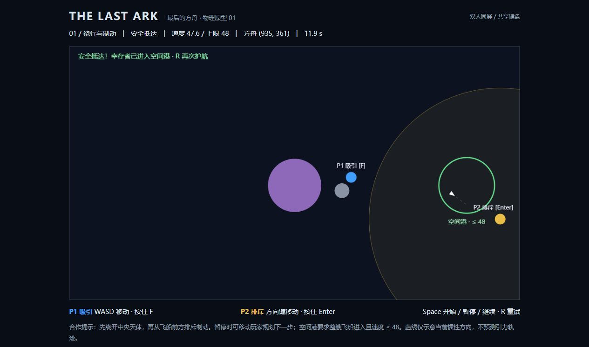

# THE LAST ARK · 最后的方舟

双人同屏合作的二维引力护航游戏。人类最后一艘移民飞船正在寻找家园，两名观察者只能通过吸引和排斥改变天体运动，不能直接驾驶飞船。

这是 **v0.1 技术原型**：用 TypeScript、Vite 和 HTML Canvas 2D 验证物理机制及第一关可玩性。没有游戏引擎、前端框架、后端服务或第三方美术/音乐。

## 启动

建议使用 Node.js 24 LTS（本地验证版本 24.20.0）及 npm。

```bash
git clone https://github.com/nathancao321-source/the-last-ark.git
cd the-last-ark
npm install
npm run dev
```

打开终端显示的本地地址，通常为 `http://127.0.0.1:5173/`。需要桌面浏览器和键盘；触屏操作尚未实现。安装后，游戏运行不需要联网。

```bash
npm test          # 自动化测试
npm run test:watch
npm run build    # TypeScript 严格检查 + 生成 dist/
npm run preview  # 本地预览生产构建
npm run check    # 测试 + 构建
```

`package-lock.json` 已提交，复现安装可使用 `npm ci`。开发服务器仅绑定本机回环地址。

## 玩法与操作

| 玩家/操作 | 按键 | 效果 |
| --- | --- | --- |
| P1 蓝色 Attractor | WASD | 自由移动 |
| P1 吸引 | 按住 F | 范围内可受力天体向 P1 加速；松开关闭 |
| P2 金色 Repulsor | 方向键 | 自由移动 |
| P2 排斥 | 按住 Enter | 范围内可受力天体远离 P2 加速；松开关闭 |
| 发射 / 暂停 / 继续 | Space | 切换模拟状态 |
| 重新开始 | R | 还原全部天体、玩家位置、速度、计时和按键状态 |

- 玩家不受引力、碰撞或反作用力影响，可穿过天体，但不能出地图边界。对角移动不会更快。
- **待发射和暂停时仍可移动两位玩家**，方便讨论和重新部署；所有天体及模拟计时完全冻结。
- 两个力场可同时作用于同一天体；合力按矢量叠加。技能也影响灰色陨石和低响应的大型天体。
- 白色三角是方舟；紫色圆是带引力的危险行星；绿色圆环是空间港。技能开启时显示作用半径。
- 白色虚线只表示当前速度的直线方向，**不是考虑引力的未来轨迹预测**。暂停时显示玩家坐标，上方显示飞船坐标与速度。
- 飞船撞击危险天体、被黑洞吞噬或任何部分越过地图边界即失败。
- 飞船碰撞圆必须完全进入空间港，且速度 **≤ 48 单位/秒** 才胜利。高速经过不会算胜利；若仍在港内，可以继续减速。
- 切换窗口或隐藏页面会清空按键并自动暂停运行中的模拟，返回后按 Space 继续。
- 方向键、Enter 和 Space 的默认网页行为已阻止。

## 第一关：绕行与制动

地图为 1100 × 620；飞船从 `(120, 340)` 以 `(65, 0)` 出发；危险行星中心 `(550, 340)`，半径 65；空间港中心 `(970, 340)`，半径 68。另有一颗可移动陨石用于验证技能的通用作用。

**完全不干预时约 5.4 秒撞上行星。** 通关需要先绕过行星，再转向空间港并制动。关卡不强制锁定每名玩家的任务分工，也没有强制双技能门锁。

<details>
<summary>展开一条经过自动化与浏览器实测的合作路线（含剧透）</summary>

1. 发射前保持 P1 在初始 `(350, 160)`；将 P2 移到空间港右下方，约 `(1050, 420)`。暂停时可以看坐标微调。
2. 开始模拟，P1 持续按 F，飞船来到 `x ≈ 420` 时松开（约 4.4 秒）。关闭力场，让飞船从行星上方惯性绕行。
3. 飞船来到 `x ≈ 650` 时暂停。P1 移到 `(690, 320)` 附近，然后继续并按住 F，使飞船逐渐向右下方转向。
4. 观察惯性虚线：当它指向空间港**下半部**、约 `(970, 390)` 时松开 F。此段约一秒多，可随时暂停确认方向，无须连续盲按。
5. P2 保持在 `(1050, 420)`，按住 Enter。前方的斥力会减速，并把飞船方向略向上修正。等待低速进入绿色圆环。

自动测试覆盖第一段松键位置 `x=410/420/430`、转向开始位置 `x=640/650/660`、惯性线目标 `y=380/390/400` 的全部 27 种组合，均可通关。测试通过暂停时的正常八方向移动部署玩家，不瞬移玩家、不修改飞船位置或速度。

2026-10-14 在实际浏览器中通过键盘操作完成此路线，结果：**11.9 秒，入港速度 47.6**。这证明基本路线可行；真人合作手感和普通键盘多键冲突仍需实际双人试玩。



</details>

## 物理与规则

- 固定步长 **1/60 秒**，`requestAnimationFrame` 只提供经过的时间并调用渲染；每帧最多补算 0.25 秒，避免后台恢复造成过量追帧。
- 每步先移动玩家，再从所有天体的同一位置快照计算加速度，最后用半隐式 Euler 更新速度和位置。计算结果不依赖逐个天体更新的位置副作用。
- 距离为 `d`、范围为 `R` 时，范围内的加速度大小为：

  `min(a_max, strength / (d² + softening²) × (1 − (d/R)²)²)`

  吸引方向指向源，排斥方向相反；范围外为 0，完全重合时为 0。软化距离、单源上限、平滑边缘和合加速度上限共同避免数值发散。
- 合加速度上限 **170 单位/秒²**，天体速度上限 **240 单位/秒**。P1 范围 280、单源上限 100；P2 范围 320、单源上限 110。
- `affectedByFields` 统一定义是否受玩家力场及自然引力影响；`gravity` 定义是否向其他天体施加引力。两个概念互相独立。
- 飞船与陨石 `response=1`；大型行星 `response=0.0001`。这是**游戏化近似**：对收到的总加速度乘很小的响应系数，使大型天体近似不动，但仍接受玩家技能。没有模拟严格质量、引力反作用或动量守恒。
- 飞船碰撞采用相对运动的扫掠圆检测，避免一个时间步穿过危险天体漏判。危险判定优先于胜利。
- 动态天体越界不会导致任务失败；越界陨石会移除。黑洞捕获陨石时移除陨石，捕获飞船时任务失败。
- 不模拟陨石之间或陨石与行星之间的弹性碰撞；本轮只实现飞船致命碰撞及黑洞吞噬规则。
- 重试从独立深拷贝状态开始；检测到非有限的天体位置或速度会进入可重试的失败状态。

## 代码结构与后续扩展

```text
src/
  physics/   vector.ts / fields.ts / world.ts / collision.ts
  game/      types.ts / game.ts / clock.ts
  levels/    first.ts
  input/     keyboard.ts
  render/    canvas.ts
  main.ts    组合输入、固定时钟、游戏更新和渲染
  style.css  最简页面布局
tests/       物理、状态、输入、时钟及关卡通关回归测试
docs/        浏览器试玩证据
```

核心逻辑不依赖 DOM、Canvas、浏览器计时或渲染帧率。`GameState` 是可序列化数据，渲染层仅消费状态。

后续精美视觉的主要扩展点：

1. 替换 `render/canvas.ts`：接入 WebGL 渲染器，保留 `stepGame` 和关卡数据。
2. 读取 `Player.field` 与 `active` 绘制引力流线/范围；读取天体位置和速度生成视觉尾迹。粒子状态放在渲染层，不回写物理状态。
3. 从 `phase`、`message`、速度和目标配置构建 HUD、胜负过场；如需音效/碰撞特效，可在规则层添加事件输出接口。
4. 新关卡通过 `Level` 配置增加对象；黑洞的 `gravity` / `captureRadius` 类型和规则已具备，可用于之后关卡。
5. `FixedClock` 可扩展为暴露插值比例，以平滑高刷新率渲染；当前不做渲染插值。
6. 将新输入设备转换为 `Controls` 即可，不需要重写物理模块。

## 已实现与未实现

已实现：双人键盘输入、吸引/排斥及叠加、可移动陨石、低响应引力行星、基础黑洞规则、边界/碰撞/低速入港、暂停规划/恢复/重试、失焦暂停、固定步长、数值限制、第一关、最简几何渲染、自动化测试、CI 配置。

未实现：第二关、黑洞试玩关卡、恒星专用对象、复杂碰撞响应、渲染插值、关卡菜单、手机/手柄操作、精美 UI、动画特效、粒子、音效音乐、剧情、账户、服务器和联网合作。

## 验证记录

2026-10-14，本地 Windows、Node.js 24.20.0、npm 11.19.0：

| 验证 | 结果与范围 |
| --- | --- |
| `npm install` | 成功，安装时审计 0 个已知漏洞 |
| `npm run dev` | 成功，本地 HTTP 开发服务与浏览器页面可用 |
| `npm test` | 47 项通过：方向/范围/上限、同点有限值、矢量叠加、陨石和行星受力、玩家隔离、生命周期、胜负、输入、时钟及 27 条通关回归 |
| 稳定性 | 10 分钟模拟时间的移动重叠力场测试，位置/速度保持有限，速度/加速度受限 |
| 帧率解耦 | 相同输入在 30、60、144 渲染 FPS 下得到完全相同的模拟状态 |
| `npm run build` | TypeScript 严格检查及 Vite 生产构建通过 |
| 实际浏览器键盘测试 | 同时移动两位玩家、启动/暂停/继续、暂停部署、吸引转向、排斥制动、真实入港成功、R 重试、无干预撞击失败 |
| 浏览器控制台 | 试玩期间未发现 warning/error |
| 真人双人试玩 | **待进行**：实体键盘多键无冲突能力、协作手感、长时间游玩和不同浏览器/屏幕体验 |
| GitHub Actions | 已配置每次 push/PR 执行安装、测试与构建；运行状态以仓库 Actions 页面为准 |

浏览器测试使用工具发送键盘事件，并实际观察 Canvas 与 HUD，不等同于两人共用实体键盘的体验验收。入港、黑洞和所有数值边界由自动化测试补充覆盖。

## 许可证

[MIT](LICENSE)。所有画面由代码绘制基础几何形状，不含第三方美术或音乐资源。
