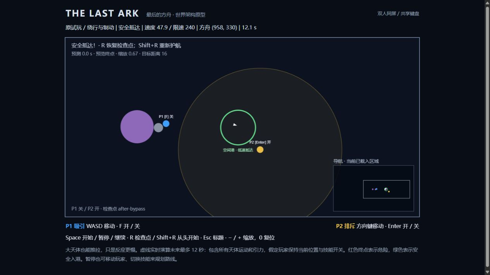

# THE LAST ARK · 最后的方舟

双人共享键盘的二维太空合作游戏。人类最后的移民飞船寻找家园，两名观察者只能通过吸引与排斥改变天体运动，不能直接驾驶方舟。

当前完成的是**大世界架构升级**，基于原有 TypeScript + Vite + Canvas 2D 原型增量开发。原试玩“绕行与制动”仍可通关；后续教学、太阳系、黑洞与无限探索只做路线设计和接口预留。完整路线与架构契约见 [GAME_DESIGN.md](docs/GAME_DESIGN.md)。

## 启动

本地验证环境：Windows、Node.js 24.20.0、npm 11.19.0。

```bash
git clone https://github.com/nathancao321-source/the-last-ark.git
cd the-last-ark
npm install
npm run dev
```

打开终端显示的地址（默认 http://127.0.0.1:5173/，占用时使用下一个端口）。当前开发页面在 http://127.0.0.1:5174/。标题页按 Space 或点击“进入原试玩关”，再按 Space 发射。游戏启动后无需联网；需要桌面键盘。

```bash
npm test           # 全部自动化测试
npm run test:watch
npm run build      # 严格类型检查 + Vite 生产构建
npm run preview    # 预览生产构建
npm run check      # 测试与构建
```

依赖版本由 package-lock.json 锁定，CI 使用 npm ci。开发服务器仅监听本机回环地址。

## 操作与玩法

| 操作 | 按键 |
| --- | --- |
| P1 蓝色玩家移动 / 切换吸引 | WASD / 点按 F |
| P2 金色玩家移动 / 切换排斥 | 方向键 / 点按 Enter |
| 进入试玩、发射、暂停、继续 | Space |
| 恢复最近检查点并关闭力场 | R |
| 从当前关卡最初状态开始 | Shift+R |
| 返回标题 | Esc |
| 缩小 / 放大 / 恢复默认视角 | − / +（等号键） / 0 |

- 技能按一下开启，再按一下关闭；松开保持，长按不会重复切换。合力按矢量叠加，飞船、陨石和可移动行星都会受力。
- 玩家不受引力或碰撞影响，对角移动不会加速。待发射和暂停时可移动玩家、调整技能；天体和计时冻结。
- 所有实体使用世界坐标，**屏幕边缘不再是边界**。镜头平滑跟随飞船并按速度前瞻；玩家离屏显示方向箭头。缩放、窗口尺寸和 DPR 不改变模拟。
- 右下角小地图显示已加载区域、玩家、方舟、目标与镜头范围；绿色边缘箭头指向当前目标。当前没有限制玩家与方舟的距离，也没有自动传送。
- 白色三角是方舟，灰圆是陨石，紫圆是可推拉的大行星，绿环为空间港。飞船撞击危险天体或进入捕获区立即失败。
- 飞船必须完整进入空间港，速度 **≤ 48 世界单位/秒** 才胜利；天体硬限速为 **240**。高速掠过不会算完成。
- 虚线是对当前全部已加载天体进行最多 12 秒的真实积分预测，10 Hz 刷新。红色表示危险，绿色表示安全抵达；它假定玩家保持当前位置及开关。暂停也能规划，不会推进真实状态。
- 失焦/页面隐藏自动暂停运行中的游戏，释放移动按键但保留技能开关。方向键、Space、Enter 不触发滚动。
- R 恢复内存检查点；Shift+R 完全重开。刷新页面或返回标题后重新进入会从关卡起点开始，目前没有持久存档。

## 保留的试玩关与通关路线

旧 1100 × 620 尺寸现在只作关卡参考，不是物理边界。飞船从 (120,340)、速度 (65,0) 出发；行星中心 (550,340)、半径 65；空间港中心 (970,340)、半径 68；原陨石保留。完全不操作时约 5.4 秒撞毁。

<details>
<summary>展开已验证的合作路线（含剧透）</summary>

1. P1 保持初始 (350,160)，将 P2 移到约 (1050,420)。
2. 按 F 开启吸引并发射。飞船到 x≈420 时关 F（约 4.4 秒），从行星上方惯性绕行。
3. 到 x≈650 时暂停，把 P1 移到 (690,320) 附近。此时正常上方绕行路线已经保存 after-bypass 检查点。
4. 开 F、继续约 1.2 秒后暂停，关 F、开 Enter，让 P2 进行制动。观察是否出现绿色“安全入港”预测。
5. 绿色时保持位置和开关继续。如果未对准，可暂停调整 P2 或短暂继续 P1 转向后再检查。

27 组原有路线覆盖关闭位置 x=410/420/430、转向位置 x=640/650/660 和三种转向结束方向；另有 3 条路线使用预测作为制动继续条件。全部只使用正常玩家移动与力场，没有修改飞船位置或速度。

本轮架构升级后实际浏览器按该路线完成：**12.1 秒、速度 47.9、方舟 (958,330)** 安全抵达。实际键盘事件工具的时长存在少量偏差，因此不要依赖毫秒级时机；暂停和轨迹预览是规划机制的一部分。

</details>



## 架构变化

```text
src/
  camera/    世界/屏幕坐标变换、平滑跟随、离屏箭头、小地图映射
  scenes/    SceneId、可用/规划场景注册表、场景控制器
  game/      统一实体定义、能力配置、任务/触发器、检查点、固定时钟、预测
  physics/   向量、软化力场、体积引力、Verlet 积分、扫掠碰撞
  world/     区域几何、多分辨率空间索引、区块接口、确定性随机数
  levels/    first.ts：保留原试玩配置与绕行检查点
  input/     双人键盘与技能开关
  render/    Canvas 基础渲染、实体可见性裁剪
  main.ts    组合场景、输入、固定时钟、镜头与视图
tests/       物理、通关、预测、相机、导航、场景、任务、检查点、空间索引
docs/        完整游戏路线与浏览器验收截图
```

**Scene 与 Phase 分离。** 场景有 title、prototype、tutorial_part_1、tutorial_part_2、solar_system、black_hole、endless；游戏阶段有 ready、running、paused、failed、completed。后续场景标记 planned，无法进入。转场由显式任务条件触发，不读取屏幕坐标。

**统一实体按能力参与模拟。** 支持 ship、player、asteroid、planet、star、black_hole、station、wormhole。motion 区分动态、静态、预设运动；emitsGravity、collision、affectedByFields、response 等可独立配置。background 实体只显示。行星默认 response=0.18，恒星默认 0.02，黑洞默认 static；太阳可弱推、黑洞不可推的差异不写进积分器名称分支。恒星/虫洞等目前只有数据支持与测试，未加入试玩内容。

**任务与触发器已经可执行。** 支持进入圆/矩形区、低速入区、移动指定天体、穿过轨道带、前置任务、阶段提示、虫洞转场、完成和检查点。原试玩使用 station 实体低速入港目标，以及绕行后检查点。R 还原实体、计时与任务记录后关闭技能，Shift+R 从头重置。

**世界装载与视觉裁剪分离。** 离屏物体继续受力、运动和碰撞；只绘制可见实体。当前试玩全部对象驻留内存。局部引力使用空间索引查询影响范围，不遍历全宇宙天体配对。区块 load/save/unload、种子派生和需求规划只是扩展接口，尚无运行中的区块加载器。

## 物理模型与保留能力

- 固定步长 1/60 秒；每帧最多补算 15 步。Velocity Verlet 分别采样天体移动前后的引力，渲染完全独立。
- 单源加速度：`min(a_max, strength / (d² + softening²) × (1 − (d/R)²)²)`；范围外与完全重合时为 0。
- 球体质量 `4πr³/3 × density`，参考半径 65、密度 1、源强度 110000；范围默认 `max(120,r×330/65)`，软化 `max(24,r×85/65)`。同密度半径翻倍源强度为 8 倍。配置可以关闭某实体的引力或覆盖作用半径。
- 合加速度上限 170，速度上限 240；可设置单体更低限速。每半步都执行限速。触及限速会丢弃动能，是游戏化取舍。
- 飞船/陨石响应 1，原行星 0.18。大天体确实能被吸走或推开，关技能后继续惯性运动。响应系数不等于严格质量反作用，不保证全系统动量守恒。
- 引力弹弓来自移动引力源本身，没有额外速度奖励。回归测试验证静止源掠飞的远场速度近似不变，以及移动源两侧分别增速/减速。
- 空间索引在每半步按当前源位置重建；多个格子中的相同候选去重，保持稳定求和顺序。危险碰撞使用扫掠 AABB 候选与相对扫掠圆检测。
- 离屏不移除天体；capture 危险可以移除非飞船动态天体。飞船捕获直接失败。只有显式 missionBounds 才会发生任务边界失败，试玩不设置该边界。
- 不模拟天体之间的弹性碰撞，不做完整天体力学。预测遇到胜负或转场停止；下一场景不由当前预测偷偷启动。

## 已实现与预留范围

| 状态 | 内容 |
| --- | --- |
| 已实现并接入试玩 | 原有合作机制、点按技能、大天体推拉、体积引力、弹弓模型、限速、预测、世界坐标、平滑镜头/前瞻/缩放、离屏提示、小地图、标题/试玩状态机、任务目标、绕行检查点、局部空间查询、可见实体裁剪 |
| 已实现通用能力并测试 | 八类实体、能力覆盖、圆/矩形/轨道带条件、依赖目标、提示/完成动作、移动目标/虫洞触发转场、独立场景配置及重置 |
| 仅设计或接口 | 两段教学、Solar Exodus、Beyond the Horizon、Endless、隐藏内容、SectorProvider、基于种子的星域生成基础、有限区块需求规划 |
| 尚未实现 | 新关卡/新星球内容、运行中的区块加载卸载、程序化宇宙、持久存档、加载过渡、Worker 预测、远场近似、渲染插值、精美 UI/特效/音效、手机/手柄、联网合作 |

后续视觉扩展：替换 render 层并继续消费 GameState / Camera / Trajectory；流线读取场源配置，尾迹读取速度，粒子维护独立展示状态；HUD 读取 SceneId / Phase / MissionState。区块扩展实现 SectorProvider 与调度器，确保保存移动态、加载跨区引力邻域，不以镜头决定物理活跃范围。详见设计文档。

## 验证记录

2026-10-14 架构升级验收：

| 检查 | 结果 |
| --- | --- |
| 原有基线 | 修改前 67 项测试与构建通过；原有 30 条通关回归在架构升级后继续通过 |
| 自动化 | 本轮 104 项测试通过；新增摄像机变换、视口独立、边缘方向、小地图、场景切换、计划场景拒绝、实体能力、任务/检查点、局部索引和确定性种子覆盖 |
| 原有数值稳定性 | 保留 10 分钟模拟、重叠力场、硬限速、不同数组顺序、静态/移动源掠飞、逐点预测一致性测试 |
| 帧率独立 | 相同输入在 30 / 60 / 144 渲染 FPS 得到相同模拟状态；改变窗口尺寸和镜头缩放不改变状态 |
| 构建 | npm run build 严格类型检查与生产打包通过 |
| 开发服务 | 现有 npm run dev 服务正常，127.0.0.1:5174 页面和热更新可用 |
| 浏览器操作 | 实测标题进入/返回、双人同时移动、点按技能、暂停/继续、镜头跟随、缩放、小地图及离屏箭头；窗口改为 800×700 后暂停坐标/速度/计时一致，随后恢复默认视口 |
| 浏览器胜负/重试 | 原路线 12.1 秒、47.9 低速抵达；R 恢复 (640,217) 绕行检查点并关闭双力场；Shift+R 回到 (120,340)；无干预约 5.4 秒撞毁 |
| 浏览器控制台 | 本轮检查未发现 warning/error |
| 真人双人验收 | 仍待实际两人共用实体键盘验证多键冲突、协作手感、长时间游玩与更多浏览器 |
| 无限宇宙性能 | 未验收：未实现无限生成/装载；只验证局部查询避免稀疏对象全配对，不能据此宣称支持任意规模 |

原始安装阶段 npm install 成功，未增加本轮运行依赖。GitHub Actions 在 push/PR 自动执行 npm ci 和 npm run check；CI 状态以仓库 Actions 最新运行结果为准。

旧版截图保留在 docs 中，当前架构验收截图为 architecture-win.png，旧截图不作为新版界面的验收证据。

## 许可证

[MIT](LICENSE)。所有画面均为代码绘制的基础几何形状，不含未经授权的美术或音乐素材。
